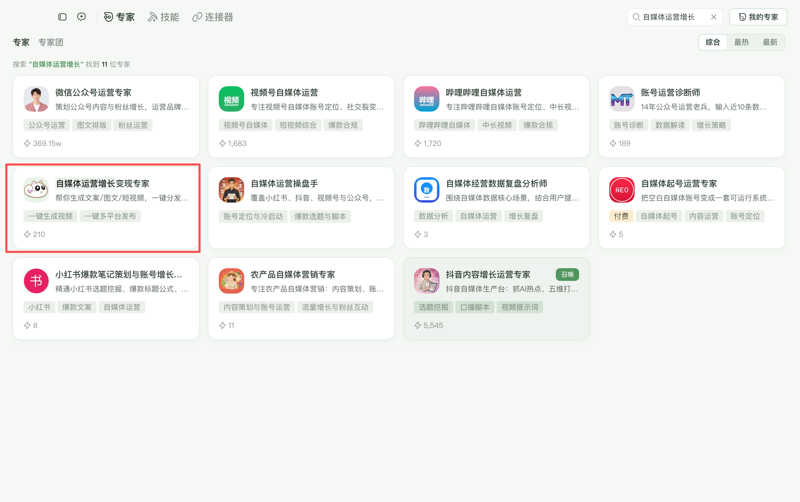

## WorkBuddy: No Install Needed

WorkBuddy users can skip the plugin installation entirely. The official expert **"AI Content Growth Assistant"** is built in — just search for it in the **Experts** tab and start chatting.

This expert comes with all AiToEarn capabilities pre-installed: one-click video generation, multi-platform publishing, image and text creation, cloud editing, and more. Ready to use out of the box.



## Install the Plugin

<Info>
The plugin is not another model. It adds AiToEarn's image, video, audio, cloud editing, and publishing capabilities to your favorite AI client. The host agent understands and generates; the plugin connects the professional tools into the conversation.
</Info>

### Prerequisites

- **AI client**: Codex, Trae / TraeWork, DeepSeek Harness, Kimi Work, Qwen Office, Qwen Desktop, or Doubao. Open it once so the installer can detect the directories.
- **AiToEarn API Key**: Sign in to [aitoearn.cn](https://aitoearn.cn) or [aitoearn.ai](https://aitoearn.ai) and create one under Settings → API Key.

<Warning>
Keys for the China and international sites are not interchangeable. Create the key on the site you actually use.
</Warning>

### Option 1: prompt

Copy the prompt below and paste it into your client's chat to install automatically:

```text
Install the plugin pack at https://github.com/yikart/AiToEarn/tree/main/skills
```

- Codex, Trae, DeepSeek Harness, and Kimi get the MCP configuration and key written automatically.
- Doubao, Qwen, and Qwen Office still need a connector set up in the client.

### Option 2: installer

1. Download and unzip the package for your system.
2. Double-click `AiToEarn管理器.command` on macOS, or `AiToEarn管理器.cmd` on Windows.
3. Choose Install, then pick your target client.
4. Paste the API key and wait for validation to finish.
5. Fully quit and reopen the client, then start a new session and send the verification prompt.

| System | Download |
| --- | --- |
| macOS | [Mac.zip](https://install-mac-windows-plugin.oss-cn-beijing.aliyuncs.com/AiToEarn-%E5%85%A8%E5%B9%B3%E5%8F%B0%E7%AE%A1%E7%90%86%E5%99%A8-Mac.zip) |
| Windows | [Windows.zip](https://install-mac-windows-plugin.oss-cn-beijing.aliyuncs.com/AiToEarn-%E5%85%A8%E5%B9%B3%E5%8F%B0%E7%AE%A1%E7%90%86%E5%99%A8-Windows.zip) |

#### What happens per client

| Client | Written automatically | What you still need to do |
| --- | --- | --- |
| Codex | Plugin, skill, MCP | Fully quit and reopen, start a new session to verify |
| Trae / TraeWork | Skill, MCP | Fully quit and reopen, start a new conversation to verify |
| DeepSeek Harness | Plugin, profile config | Reopen the client and start a new session to verify |
| Kimi Work | Skill, plugin marketplace, MCP | Fully quit and reopen; on Windows, click install in the plugin marketplace if prompted |
| Qwen Office | Plugin + connector JSON | Reopen, then go to Extensions → Connectors → Add → Import JSON and paste the config the manager copied |
| Qwen Desktop | Skill into local skill library | Reopen, go to Connect, and add the HTTP MCP manually as prompted |
| Doubao | Skill pack to Downloads | Import the skill in Doubao, create a custom connector, and fill in the key |

## Verify

After installing, fully quit the client, reopen it, start a new session, and send:

```text
List the available publishing channels
```

If it returns the channel directory, the plugin is connected.

## FAQ

**Tools are missing**: Fully quit and reopen the client. Closing the window alone usually doesn't reload MCP.

**`-32001` unauthorized**: Check that the key belongs to the site you're on and is still valid. Don't use a key across sites.

**Platforms show up but accounts don't**: Re-authorize by scanning the QR code under My Channels in AiToEarn, then have the agent query accounts again.

**Publishing fails**: Have the agent read the failure reason and platform rules first; don't resubmit unchanged. Failed publishing tasks usually need a new publish flow.

## Uninstall

Run the installer again, choose Uninstall with the target client. The Doubao connector must be removed manually inside Doubao.
