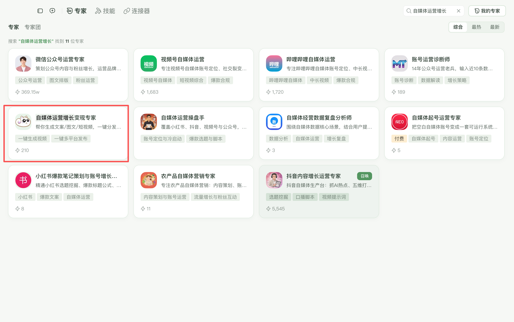

## WorkBuddy: No Install Needed

WorkBuddy users can skip the plugin installation entirely. The official expert **"AI Content Growth Assistant"** is built in — just search for it in the **Experts** tab and start chatting.

This expert comes with all AiToEarn capabilities pre-installed: one-click video generation, multi-platform publishing, image and text creation, cloud editing, and more. Ready to use out of the box.



## Install the Plugin

<Info>
The plugin is not another model. It adds AiToEarn's image, video, audio, cloud editing, and publishing capabilities to your favorite AI client. The host agent understands and generates; the plugin connects the professional tools into the conversation.
</Info>

### Prerequisites

- **AI client**: Codex, Claude Code, Trae / TraeWork, DeepSeek Harness, Kimi Work, Qwen Office, Qwen Desktop, or Doubao. Open it once before installing.
- **AiToEarn account**: An account on [aitoearn.cn](https://aitoearn.cn) or [aitoearn.ai](https://aitoearn.ai) is all you need. The plugin now uses OAuth — **no API Key anymore**. You authorize in the browser after installing.

<Warning>
Authorizations for the China and International versions are not interchangeable. Authorize on the version you actually use.
</Warning>

<Warning>
**Upgrading from the old (API Key) plugin**: remove the old plugin and its MCP/connector entries (including any API Key) first, then reinstall and complete OAuth authorization again.
</Warning>

### Install with a prompt

Each client maps to one package directory. Replace `<package-dir>` in the prompt below with the directory for your client (see the table), state whether to install the **China version** or the **International version**, then paste it into your client's chat:

```text
Install the AiToEarn plugin package at https://github.com/yikart/AiToEarn/tree/main/skills/<package-dir> (China version). Download only that directory (e.g. git sparse checkout, or extract just this subdirectory from the repository archive) — do NOT clone the whole repository. Then follow the package's README.md and 安装提示词.md to finish installation, guide me through OAuth authorization, and verify with "List my available publishing channels".
```

| Client | Package directory |
| --- | --- |
| Codex | `codex-plugin-aitoearn` |
| Claude Code | `claude-plugin-aitoearn` |
| Trae / TraeWork | `trae-skill-aitoearn` |
| DeepSeek Harness | `dsh-plugin-aitoearn` |
| Kimi Work | `kimi-plugin-aitoearn` |
| Qwen Office | `qwenwork-plugin-aitoearn` |
| Qwen Desktop | `qwen-skill-aitoearn` |
| Doubao | `doubao-skill-aitoearn` |

- For the International version, replace "China version" with "International version" in the prompt; everything else stays the same. Each package README also ships a ready-to-copy bilingual prompt at the top.
- Codex, Claude Code, Trae, DeepSeek Harness, and Kimi get the MCP configuration written automatically — no key to fill in.
- Doubao, Qwen, and Qwen Office still need a connector set up in the client (name, transport, and URL only).
- After installing, **go to the client's MCP/connector settings and start authentication for the AiToEarn connection yourself**, then finish OAuth in the browser. Don't wait for the client to pop up an authorization window.
- **Codex on the China version**: switch the connection type from "Auto" to "Dynamic client registration (DCR)" before authenticating (desktop app: Settings → Plugins → MCP; CLI: `codex mcp login aitoearn-cn --oauth-client-registration dcr`). The default CIMD flow shows an "Application configuration error" page. The International version has no such issue — the default flow works (verified).

### Per-client authentication and verification

| Client | Written automatically | What you still need to do |
| --- | --- | --- |
| Codex | Plugin, skill, MCP | China version: Settings → Plugins → MCP, set the connection type to "Dynamic client registration (DCR)", click Authenticate and finish in the browser. International version: the default connection type works as-is (verified, no DCR needed). Then reopen and verify in a new session |
| Claude Code | Plugin, skill, MCP | After restarting, run `/mcp`, start authentication for the AiToEarn server, and finish in the browser |
| Trae / TraeWork | Skill, MCP | Reopen, then click connect/authenticate on the AiToEarn connection in MCP settings and finish in the browser |
| DeepSeek Harness | Plugin, profile config | Run `aitoearn login` to complete OAuth (browser or device code), then reopen the client and verify |
| Kimi Work | Skill, plugin marketplace, MCP | Fully quit and reopen, then start authentication for the AiToEarn connection on the MCP connections page; on Windows, click install in the plugin marketplace if prompted |
| Qwen Office | Plugin + connector JSON | Reopen, go to Extensions → Connectors → Add → Import JSON, then click connect/authorize on the connector and finish in the browser |
| Qwen Desktop | Skill into local skill library | Reopen, add the HTTP MCP under Connect, then start authorization for that connection |
| Doubao | Skill pack to Downloads | Import the skill in Doubao, create a custom connector (name, transport, URL only), then click connect/authorize and finish in the browser |

## Switch between China and International versions

Authorizations for the two versions are not interchangeable, and only one connection should exist at a time. To switch:

1. Delete the current AiToEarn connection (`aitoearn-cn` or `aitoearn`) in the client's MCP/connector settings; on DeepSeek Harness, run `aitoearn logout` instead.
2. Re-add the target version: China version `aitoearn-cn` + `https://aitoearn.cn/api/ai/agent/mcp`; International version `aitoearn` + `https://aitoearn.ai/api/ai/agent/mcp`. On DeepSeek Harness, log in again with `aitoearn login` (China) or `aitoearn login --site ai` (International).
3. Complete OAuth authorization again, then verify in a new session with "List my available publishing channels".

See the "切换中国版 / 国际版" section in each package README for client-specific steps.

## Verify

After installing, fully quit the client, reopen it, start a new session, and send:

```text
List the available publishing channels
```

If it returns the channel directory, the plugin is connected.

## FAQ

**Tools are missing**: Fully quit and reopen the client. Closing the window alone usually doesn't reload MCP.

**`-32001` unauthorized**: OAuth authorization is incomplete or expired. Start authentication again for the AiToEarn connection in the MCP/connector settings, and make sure you authorize on the version you're actually using — the China and International versions are not interchangeable.

**Codex shows "Application configuration error" on the authorization page** (China version only): the connection type is still "Auto/CIMD". Switch it to "Dynamic client registration (DCR)" and authenticate again.

**Platforms show up but accounts don't**: Re-authorize by scanning the QR code under My Channels in AiToEarn, then have the agent query accounts again.

**Publishing fails**: Have the agent read the failure reason and platform rules first; don't resubmit unchanged. Failed publishing tasks usually need a new publish flow.

## Uninstall

Uninstall the AiToEarn plugin/skill in the client and remove the corresponding AiToEarn MCP/connector entries. The Doubao connector must be removed manually inside Doubao.
