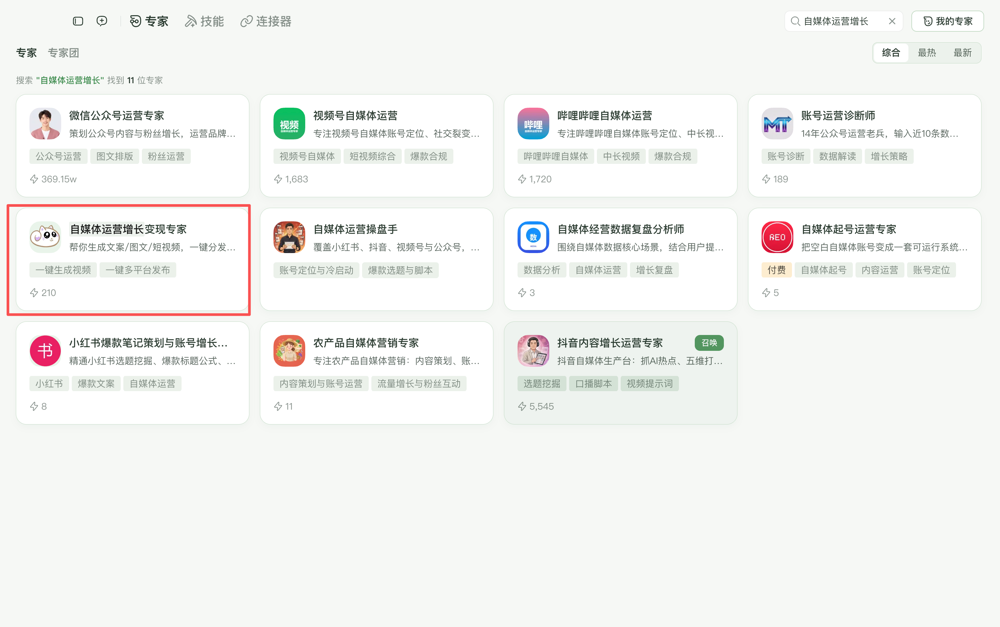

## WorkBuddy 免安装

WorkBuddy 用户无需安装插件，直接使用内置官方专家「自媒体运营增长变现专家」。在「专家」页搜索名称即可开始对话。

该专家已预装 AiToEarn 全部能力：一键生成视频、一键多平台发布、图文创作、云剪辑等，开箱即用。



## 插件安装

<Info>
插件不是另一个大模型。它在你常用的 AI 客户端里接入 AiToEarn 的图片、视频、音频、云剪辑和发布能力。宿主 agent 负责理解和生成，插件负责把专业工具接进对话。
</Info>

### 前置条件

- **AI 客户端**：Codex、Claude Code、Trae / TraeWork、DeepSeek Harness、Kimi Work、千问办公、千问桌面端或豆包，安装前先打开一次。
- **AiToEarn 账号**：能登录 [aitoearn.cn](https://aitoearn.cn) 或 [aitoearn.ai](https://aitoearn.ai) 即可。插件已全面改用 OAuth 鉴权，**不再需要 API Key**；安装后按提示在浏览器完成授权。

<Warning>
中国版和国际版的授权互不通用，用你实际使用的那个版本完成授权。
</Warning>

<Warning>
**安装过旧版（API Key）插件的用户**：先删除旧插件和旧的 MCP/连接器配置（含旧 API Key），再重新安装，并重新完成 OAuth 授权。
</Warning>

### 提示词安装

每个客户端对应一个包目录。把下面提示词中的 `<包目录>` 换成你的客户端对应的目录（见下表），并写明安装**中国版**还是**国际版**，然后发送到客户端对话框即可自动安装：

```text
帮我安装 https://github.com/yikart/AiToEarn/tree/main/skills/<包目录> 的插件包（中国版）。只下载该目录（例如 git sparse checkout，或只解压仓库压缩包中的这个子目录），不要克隆整个仓库。下载后按包内 README.md 和 安装提示词.md 完成安装，引导我完成 OAuth 授权，最后用「列出可用的发布渠道」验证。
```

| 客户端 | 包目录 |
| --- | --- |
| Codex | `codex-plugin-aitoearn` |
| Claude Code | `claude-plugin-aitoearn` |
| Trae / TraeWork | `trae-skill-aitoearn` |
| DeepSeek Harness | `dsh-plugin-aitoearn` |
| Kimi Work | `kimi-plugin-aitoearn` |
| 千问办公 | `qwenwork-plugin-aitoearn` |
| 千问桌面端 | `qwen-skill-aitoearn` |
| 豆包 | `doubao-skill-aitoearn` |

- 安装国际版时把提示词里的「中国版」改为「国际版」，其余不变；各包 README 顶部附有可直接复制的同款中英双语提示词。
- Codex、Claude Code、Trae、DeepSeek Harness、Kimi 会自动写入 MCP 配置，无需填写任何 Key。
- 豆包、千问、千问办公还需要在客户端里手动配置连接器（只填名称、传输方式和 URL）。
- 安装完成后，**到客户端的 MCP/连接器管理页面对 AiToEarn 连接主动发起认证**，在浏览器完成 OAuth 登录；不要等待客户端自动弹出授权窗口。
- **Codex 中国版特别注意**：把连接类型从「自动」改为「动态客户端注册 (DCR)」再认证（桌面版：设置 → 插件 → MCP；命令行：`codex mcp login aitoearn-cn --oauth-client-registration dcr`）。默认的 CIMD 方式会显示「应用配置错误」。国际版无此问题，默认方式即可（已实测）。

### 各客户端认证与验证

| 客户端 | 自动写入 | 你还需要做什么 |
| --- | --- | --- |
| Codex | 插件、技能、MCP | 中国版：设置 → 插件 → MCP，连接类型选「动态客户端注册 (DCR)」，点「进行身份验证」完成浏览器授权；国际版：默认连接类型直接认证即可（已实测，无需 DCR）。重开后新建会话验证 |
| Claude Code | 插件、技能、MCP | 重启后输入 `/mcp` 打开面板，对 AiToEarn server 主动发起认证，在浏览器完成授权 |
| Trae / TraeWork | 技能、MCP | 重开后到 MCP 设置对 AiToEarn 连接点击连接/认证，在浏览器完成授权 |
| DeepSeek Harness | 插件、profile 配置 | 运行 `aitoearn login` 完成 OAuth 授权（浏览器或设备码），重开客户端验证 |
| Kimi Work | 技能、插件市场、MCP | 完全退出后重开，到 MCP 连接管理页对 AiToEarn 连接发起认证；Windows 下如提示需要，在插件市场点击安装 |
| 千问办公 | 插件 + 连接器 JSON | 重开后进入「扩展 → 连接器 → 添加 → 导入 JSON」，再对连接器点击连接/授权完成浏览器登录 |
| 千问桌面端 | 技能到本机技能库 | 重开后进入「连接」手动添加 HTTP MCP，然后对该连接发起授权 |
| 豆包 | 技能包到下载目录 | 在豆包导入技能，新建自定义连接器（只填名称、传输方式、URL），再点击连接/授权完成浏览器登录 |

## 切换中国版 / 国际版

两个版本的授权不通用，任何时候只保留一个连接。切换步骤：

1. 在客户端的 MCP/连接器管理页删除当前 AiToEarn 连接（`aitoearn-cn` 或 `aitoearn`）；DeepSeek Harness 改为运行 `aitoearn logout`。
2. 按目标版本重新添加：中国版 `aitoearn-cn` + `https://aitoearn.cn/api/ai/agent/mcp`；国际版 `aitoearn` + `https://aitoearn.ai/api/ai/agent/mcp`。DeepSeek Harness 用 `aitoearn login`（中国版）或 `aitoearn login --site ai`（国际版）重新登录。
3. 重新完成 OAuth 授权，新会话发送「列出可用的发布渠道」验证。

各客户端的详细步骤见对应包 README 的「切换中国版 / 国际版」一节。

## 验证安装

装完后完全退出客户端、重新打开，新建会话发送：

```text
列出可用的发布渠道
```

能返回渠道目录，说明插件已经接通。

## 常见问题

**找不到工具**：完全退出客户端后重开，只关窗口通常不会重新加载 MCP。

**提示 `-32001` 未授权**：OAuth 授权未完成或已过期。到 MCP/连接器管理页对 AiToEarn 连接重新发起认证；确认授权的是当前使用的版本，中国版和国际版不通用。

**Codex 授权页显示「应用配置错误」**（仅中国版）：连接类型停在了「自动/CIMD」。改成「动态客户端注册 (DCR)」后重新认证即可。

**能看到平台但看不到账号**：去 AiToEarn 的「我的频道」扫码授权，再让 agent 查询账号。

**发布失败**：让 agent 读取失败原因和平台规则，不要原样重复提交；失败的发布任务需要重新创建发布流程。

## 卸载

在客户端卸载 AiToEarn 插件/技能，并删除对应的 AiToEarn MCP/连接器条目。豆包连接器需要在豆包客户端内手动删除。
