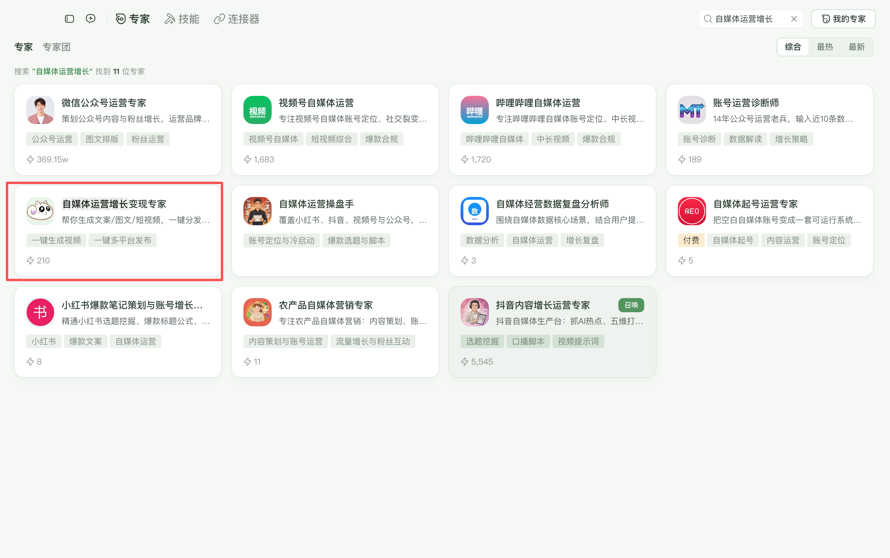

## WorkBuddy 免安装

WorkBuddy 用户无需安装插件，直接使用内置官方专家「自媒体运营增长变现专家」。在「专家」页搜索名称即可开始对话。

该专家已预装 AiToEarn 全部能力：一键生成视频、一键多平台发布、图文创作、云剪辑等，开箱即用。



## 插件安装

<Info>
插件不是另一个大模型。它在你常用的 AI 客户端里接入 AiToEarn 的图片、视频、音频、云剪辑和发布能力。宿主 agent 负责理解和生成，插件负责把专业工具接进对话。
</Info>

### 前置条件

- **AI 客户端**：Codex、Trae / TraeWork、DeepSeek Harness、Kimi Work、千问办公、千问桌面端或豆包，先打开一次让安装器识别目录。
- **AiToEarn API Key**：登录 [aitoearn.cn](https://aitoearn.cn) 或 [aitoearn.ai](https://aitoearn.ai)，在「设置 → API Key」中创建。

<Warning>
中国站和国际站的 Key 互不通用，用你实际使用的那个站点创建。
</Warning>

### 方式一：提示词

复制下面提示词，发送到各平台对话框中即可自动安装：

```text
帮我安装 https://github.com/yikart/AiToEarn/tree/main/skills 的插件包
```

- Codex、Trae、DeepSeek Harness、Kimi 会自动写入 MCP 配置和 Key。
- 豆包、千问、千问办公还需要在客户端里手动配置连接器。

### 方式二：安装器

1. 下载并解压对应系统的安装包。
2. macOS 双击 `AiToEarn管理器.command`；Windows 双击 `AiToEarn管理器.cmd`。
3. 选择「安装」，然后选目标客户端。
4. 粘贴 API Key，等待校验完成。
5. 完全退出并重新打开客户端，新建会话发送验证指令。

| 系统 | 下载 |
| --- | --- |
| macOS | [Mac.zip](https://install-mac-windows-plugin.oss-cn-beijing.aliyuncs.com/AiToEarn-%E5%85%A8%E5%B9%B3%E5%8F%B0%E7%AE%A1%E7%90%86%E5%99%A8-Mac.zip) |
| Windows | [Windows.zip](https://install-mac-windows-plugin.oss-cn-beijing.aliyuncs.com/AiToEarn-%E5%85%A8%E5%B9%B3%E5%8F%B0%E7%AE%A1%E7%90%86%E5%99%A8-Windows.zip) |

#### 各客户端后续操作

| 客户端 | 自动写入 | 你还需要做什么 |
| --- | --- | --- |
| Codex | 插件、技能、MCP | 完全退出后重开，新建会话验证 |
| Trae / TraeWork | 技能、MCP | 完全退出后重开，新建对话验证 |
| DeepSeek Harness | 插件、profile 配置 | 重开客户端，新建会话验证 |
| Kimi Work | 技能、插件市场、MCP | 完全退出后重开；Windows 下如提示需要，在插件市场点击安装 |
| 千问办公 | 插件 + 连接器 JSON | 重开后进入「扩展 → 连接器 → 添加 → 导入 JSON」，粘贴管理器复制的配置 |
| 千问桌面端 | 技能到本机技能库 | 重开后进入「连接」，按弹窗手动添加 HTTP MCP |
| 豆包 | 技能包到下载目录 | 在豆包导入技能，新建自定义连接器并填入 Key |

## 验证安装

装完后完全退出客户端、重新打开，新建会话发送：

```text
列出可用的发布渠道
```

能返回渠道目录，说明插件已经接通。

## 常见问题

**找不到工具**：完全退出客户端后重开，只关窗口通常不会重新加载 MCP。

**提示 `-32001` 未授权**：检查 Key 是否属于当前站点、是否仍然有效，不要跨站使用。

**能看到平台但看不到账号**：去 AiToEarn 的「我的频道」扫码授权，再让 agent 查询账号。

**发布失败**：让 agent 读取失败原因和平台规则，不要原样重复提交；失败的发布任务需要重新创建发布流程。

## 卸载

再次运行安装器，选择「卸载」和目标客户端。豆包连接器需要在豆包客户端内手动删除。
